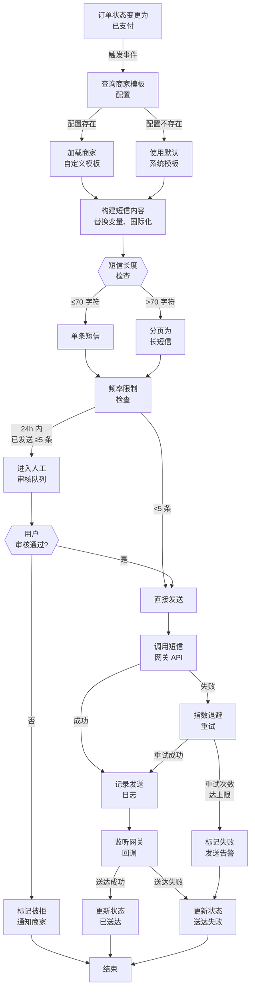

# Markdown 规格文档结构模板

> 本模板规定了 feature-documenter 输出的 Markdown 文档的标准结构与必填项。使用此模板可确保文档的一致性、完整性与工程师友好性。

---

# 【功能名称】规格文档

> **最后更新**：YYYY-MM-DD  
> **版本**：v1.0  
> **作者** / **维护者**：[Name/Team]  
> **状态**：草案 / 评审中 / 已批准 / 已发布

---

## 1. 使用背景 (Background)

### 1.1 问题陈述与用户痛点

用 2-3 句清晰描述用户面对的核心问题。回答"为什么需要这个功能"。

**示例**：
> 当前订单确认流程需要客服手工发送短信，效率低下（平均 8 分钟/单）。每日 1w 单量意味着 80 个工时浪费。商家期望自动化短信发送，同时保持个性化消息能力。

### 1.2 商业目标与成功指标 (KPIs)

列举 3-5 个可量化的目标：

| 目标 | 基线 | 目标值 | 测量方法 |
| --- | --- | --- | --- |
| 订单确认延迟 | 8 分钟 | < 10 秒 | 系统埋点 |
| 客服工时节省 | 80 工时/天 | 95% 自动化率 | 工单系统统计 |
| 用户短信到达率 | 96% | > 98% | 短信网关反馈 |
| 支持语言 | 仅中文 | 支持 5+ 语言 | 国际版上线数 |

### 1.3 Stakeholder 地图

列举一级、二级利益相关方及其诉求：

| 角色 | 诉求 | 优先级 |
| --- | --- | --- |
| **一级** | | |
| 商家・运营 | 自动化、降成本、可个性化 | P0 |
| 最终消费者 | 及时通知、可选择(不骚扰) | P0 |
| **二级** | | |
| 短信供应商 | 提供可靠网关、成本优化 | P1 |
| 合规 / 法务 | 符合 GDPR、垃圾信息法规 | P0 |
| **平台方** | | |
| 产品团队 | 可观测、易扩展、可灰度 | P1 |
| 数据团队 | 完整埋点、隐私合规 | P1 |

### 1.4 监管 & 合规背景

涉及跨境 / 数据 / 金融的功能应列出法规要求：

**中国**：
- 《反垃圾短信管理办法》：频率限制，需用户主动订阅
- 《个人信息保护法 (PIPL)》：数据最小化、脱敏要求
- 相关链接：[工信部文件](https://example.com) (发布：2025-12-01)

**欧盟 (若涉及)**：
- GDPR 第 21 条：用户撤销权
- 国际链接：[GDPR Article 21](https://gdpr-info.eu/) (最后访问：2026-04-08)

---

## 2. 功能逻辑 (Feature Logic)

### 2.1 核心流程（伪代码 / 编号清单）

```
1. 订单在"待支付"状态下变更为"已支付"
   └─ 触发事件：order.paid
   
2. 系统查询商家短信模板配置
   └─ 若无配置 → 使用默认模板 → 见 2.3
   └─ 有配置 → 加载商家自定义模板

3. 构建短信内容
   ├─ 替换变量：{order_id}、{product_name}、{total_price}
   ├─ 国际化：根据用户语言选择模板版本
   └─ 长度检查：若 > 70 字符 → 自动分页为长短信

4. 频率检查（反垃圾）
   └─ 查询用户过去 24h 短信数量
       └─ if count > 5：进入人工审核队列，延迟发送
       └─ else：直接发送

5. 发送短信到网关
   ├─ 构造请求：batch_id、phone、content、timestamp
   ├─ 使用主网关（成功率 99% 以上）
   └─ if 网关异常 → 自动重试，指数退避（1s, 2s, 4s, 8s）

6. 记录发送日志与埋点
   └─ 日志 schema（见 2.4）
   
7. 监听短信网关回调
   └─ 成功：更新发送状态为"已送达"
   └─ 失败：重试或标记失败、发送告警
```

### 2.2 Mermaid 流程图


**流程图说明**：共 20 个节点，包括 5 个判断菱形、3 个错误路径、2 个人工干预点。

### 2.3 状态机 (若适用)

```
┌─────────────┐
│   INIT      │ (初始化、待配置)
└──────┬──────┘
       │ 商家填写模板
       ↓
┌──────────────────────┐
│ TEMPLATE_CONFIGURED  │ (模板已配置)
└──────┬───────────────┘
       │ 订单支付事件
       ↓
┌──────────────────────┐
│ SENDING              │ (发送中)
└──┬────────┬─────┬────┘
   │        │     │
   │        │     └────→ TIMEOUT━┓
   │        │                    ├─→ RETRY
   │        │                    │
   │        └────→ RATE_LIMIT───┐│
   │                             ││
   └────→ SUCCESS ───────┐       ││
                         │       ││
                         ↓       ↓↓
                    ┌────────────────┐
                    │ DELIVERED      │
                    │ (已送达)        │
                    └────────────────┘

┌──────────────────────┐
│ DELIVERY_FAILED      │ (送达失败)
└──────────────────────┘
(来自 RETRY 用尽或 TIMEOUT 超期)
```

---

## 3. 功能设置及应用场景 (Settings & Application Scenarios)

### 3.1 管理员杠杆 (Admin Levers)

列举可由 Admin / DevOps 配置的参数：

| 参数名 | 类型 | 默认值 | 范围 | 影响范围 | 修改权限 |
| --- | --- | --- | --- | --- | --- |
| `sms_gateway_provider` | enum | primary_gateway | {primary, backup} | 所有发送 | Admin + Ops |
| `max_retry_times` | int | 3 | [1, 10] | 失败重试 | DevOps |
| `retry_backoff_base` | float | 1.0 | [0.5, 5.0] | 重试延迟 (s) | DevOps |
| `daily_sms_quota_per_user` | int | 5 | [1, 50] | 频率限制 | Business |
| `enable_personalization` | bool | true | — | 商家个性化 | Product |
| `supported_languages` | list | ["zh-CN"] | [all ISO 639] | 国际化 | Product |
| `content_filter_enabled` | bool | true | — | 敏感词过滤 | Compliance |

### 3.2 用户端选项 (User-Facing Settings)

商家 / 运营在后台配置的选项：

| 选项 | 类型 | 默认值 | 说明 | 验证规则 |
| --- | --- | --- | --- | --- |
| 短信模板 | text | "您的订单已确认..." | 支持 Handlebars 变量，max 200 字 | `{{order_id}}`、`{{total}}` 合法 |
| 发送时段 | time_range | 09:00~21:00 | 避免骚扰，do_not_disturb 时段 | 合法时段格式 |
| 接收人群 | filter | 全部用户 | 按性别、地域、订单金额分群 | filter 字段存在 |
| 语言偏好 | select | 用户账号语言 | 单选, 见 3.1 | 支持的语言列表 |

### 3.3 应用场景矩阵 (Scenario Matrix)

| 场景 | 用户角色 | 环境条件 | 预期行为 | 约束条件 |
| --- | --- | --- | --- | --- |
| **高峰小时** | 运营 | 日 10w+ 订单、网关 QPS 限制 1000 | 自动降级：删除个性化、合并模板 | p99 延迟 < 5s |
| **国际用户** | 商家 (面向欧美) | GDPR 生效、用户撤销权 active | 检查用户偏好、honor 退订 | 100% 法规覆盖 |
| **敏感词触发** | Content Team | 模板含敏感政治词汇 | 人工审核队列，delay 发送 | 历史漏洞率 < 1% |
| **网关故障** | 平台 SRE | 主网关宕机 (RTO < 5m) | 自动切换备用网关，继续发送 | 无消息丢失 |
| **低频用户** | 消费者 (内向) | 7 天无订单后下单 | 发送欢迎回归短信 + 优惠券 | Opt-in 前提 |

---

## 4. 公式计算细节 (Formulas & Calculations)

### 4.1 短信成本计算

**公式**：
$$\text{Daily\_Cost} = \sum_{i=1}^{n} \text{SMS\_Count}_i \times \text{Unit\_Price}$$

**参数定义**：

| 参数 | 符号 | 单位 | 精度 | 范围 | 备注 |
| --- | --- | --- | --- | --- | --- |
| 短信总数 | $\sum \text{SMS\_Count}_i$ | 条 | 整数 | [0, ∞) | 按商家聚合 |
| 单位价格 | $\text{Unit\_Price}$ | CNY/条 | 0.01 | [0.01, 1.0] | 根据长短信调整 |
| 日均成本 | $\text{Daily\_Cost}$ | CNY | 0.01 | [0, ∞) | 四舍五入 |

**场景 1：正常日期**
- 日均订单 1w 单
- 到达率 95%
- 发送短信 = 1w × 95% = 9500 条
- 单价 = 0.05 CNY/条
- 日均成本 = 9500 × 0.05 = **¥475**

**场景 2：高峰日期（假日）**
- 日均订单 5w 单
- 到达率 98%（投入资源提升）
- 发送短信 = 5w × 98% = 49000 条
- 单价 = 0.045 CNY/条（量大折扣）
- 日均成本 = 49000 × 0.045 = **¥2,205**

**验证脚本** (Python)：
```python
def calculate_daily_sms_cost(orders, delivery_rate, unit_price, precision=2):
    """计算日均短信成本"""
    from decimal import Decimal, ROUND_HALF_UP
    
    sms_count = int(orders * delivery_rate)
    cost = Decimal(str(sms_count)) * Decimal(str(unit_price))
    return float(cost.quantize(Decimal('0.01'), rounding=ROUND_HALF_UP))

# 正常日
assert calculate_daily_sms_cost(10000, 0.95, 0.05) == 475.0
# 高峰日
assert calculate_daily_sms_cost(50000, 0.98, 0.045) == 2205.0
print("✅ 成本计算验证通过")
```

### 4.2 重试延迟计算（指数退避）

**公式** (Exponential Backoff):
$$\text{Delay}(n) = \text{base\_delay} \times 2^{n-1} + \text{jitter}$$

其中：
- $n$ = 第 $n$ 次重试（$n \geq 1$）
- $\text{base\_delay}$ = 基础延迟（秒），默认 1s
- $\text{jitter}$ = 随机抖动 $\in [0, \text{base\_delay})$，避免雷群

**参数表**：

| 参数 | 值 | 单位 | 精度 |
| --- | --- | --- | --- |
| base_delay | 1 | s | 小数点后 2 位 |
| max_delay_cap | 60 | s | 防暴走 |
| max_retry_times | 3 | 次 | 整数 |

**计算示例**：

| 重试次数 $n$ | 计算 | 结果 (s) | 含 jitter (示例) |
| --- | --- | --- | --- |
| 1st | $1 \times 2^0 + [0,1)$ | 1 | 1.42 |
| 2nd | $1 \times 2^1 + [0,1)$ | 2 | 2.63 |
| 3rd | $1 \times 2^2 + [0,1)$ | 4 | 4.15 |
| 4th (capped) | $\min(8, 60) + [0,1)$ | 8 | 8.53 (超过 3 次停止) |

**验证脚本**：
```python
import random
random.seed(42)

def calculate_retry_delay(attempt, base_delay=1, max_delay=60):
    """计算指数退避延迟（含 jitter）"""
    delay = (base_delay * (2 ** (attempt - 1))) + random.uniform(0, base_delay)
    return min(delay, max_delay)

# 测试三次重试
for i in range(1, 4):
    delay = calculate_retry_delay(i)
    print(f"重试 {i}: {delay:.2f}s")
```

---

## 5. 边界与异常 (Edge & Error Cases)

### 5.1 超时 & 重试策略

| 场景 | 超时值 | 重试次数 | Backoff 系数 | Fallback 策略 |
| --- | --- | --- | --- | --- |
| 网关连接 | 5s | 3 | 2x exp | 切换备用网关 |
| 模板渲染 | 2s | 1 | — | 使用默认模板 |
| 短信到达回调 | 24h | 0 | — | 标记"待回调确认" |

### 5.2 错误码 & 处理

| 错误码 | 含义 | HTTP 状态 | 处理措施 |
| --- | --- | --- | --- |
| 1001 | 非法手机号 | 400 | 通知商家，可重新输入 |
| 1002 | 模板不存在 | 404 | 回退默认模板 |
| 2001 | 网关超时 | 502 | 指数退避重试 |
| 2002 | 配额限制 | 429 | 排入队列，等待限流恢复 |
| 3001 | 敏感词触发 | 403 | 人工审核 + delay |
| 9999 | 未知错误 | 500 | 告警 SRE，用户后续重试 |

### 5.3 反欺诈 & 安全

**频率限制 (Rate Limit)**：
- 同用户 24h 内最多 5 条短信 (见 3.1)
- 同手机号在 1 分钟内最多 1 通（防轰炸）
- 同商家日均上限：100w 条（按 SLA 约定）

**幂等性 (Idempotency)**：
- 每次请求应携带 `idempotency_key`（UUID）
- 存储 key → response 映射，24h TTL
- 重复请求返回首次结果，不重新发送

**审计日志** (Logging Schema):
```json
{
  "timestamp": "2026-04-08T14:32:15Z",
  "request_id": "req_abc123xyz",
  "idempotency_key": "idp_uuid",
  "merchant_id": 12345,
  "user_phone": "+86*****6789",  // 脱敏
  "template_id": "tpl_9876",
  "sms_content": "[内容脱敏或 hash]",
  "status": "sent_success",
  "retry_count": 1,
  "network_latency_ms": 234,
  "gateway_response_code": "0",
  "audit_level": "info|warn|error"
}
```

**可观测性 (Observability)**：
- Metric: `sms.sent_total`, `sms.delivery_success_rate`, `sms.retry_count_p95`
- Alert: 成功率 < 95% 或 p99 延迟 > 10s，触发告警
- Trace (APM): 支持 OpenTelemetry 集成

---

## 6. 附录 (Appendix)

### 6.1 源链接清单

| 序号 | 资源 | 链接 | 发布日期 | 一句话摘要 |
| --- | --- | --- | --- | --- |
| 1 | 反垃圾短信管理办法 | [工信部](https://example.com) | 2025-12-01 | 明确频率限制与订阅规范 |
| 2 | GDPR 第 21 条 | [GDPR-Info](https://gdpr-info.eu/articles/right-to-object/) | ongoing | 用户撤销权、数据可携权 |
| 3 | Twilio SMS 文档 | [Twilio Docs](https://www.twilio.com/docs/sms) | 2026-03-15 | 网关 API、错误码参考 |
| 4 | 竞品对标 (阿里云短信) | [Aliyun SMS](https://www.aliyun.com/) | 2026-03-20 | 成本模型、高可用方案 |
| 5 | RFC 3986 (URI 编码) | [RFC 3986](https://tools.ietf.org/html/rfc3986) | 2005-01-01 | URL 编码标准，用于模板变量 |

### 6.2 术语表 (Glossary)

| 术语 | 英文 | 定义 | 示例 |
| --- | --- | --- | --- |
| 短信 | SMS | Short Message Service，文本消息服务 | 最长 160 个 ASCII 字符 |
| 长短信 | Long SMS | 超过单条字符限制，自动分页的短信 | 1000 字分 7 条长短信 |
| 到达率 | Delivery Rate | 实际送达 / 发送尝试的比例 | 95% 表示 100 条里 95 条到达 |
| 重试 | Retry | 首次失败后的重新尝试 | 指数退避：1s, 2s, 4s, ... |
| 幂等性 | Idempotency | 相同请求多次调用，结果一致 | 使用 idempotency_key 保证 |
| 频率限制 | Rate Limit | 单位时间内的请求数上限 | 同用户日均 5 条短信 |
| 降级 | Graceful Degradation | 功能部分失效时的优雅处理 | 网关故障时使用备用网关 |
| 埋点 | Instrumentation | 在代码中插入可观测性代码 | 记录 send / delivery 事件 |

### 6.3 变更日志 (Changelog)

| 版本 | 日期 | 作者 | 描述 |
| --- | --- | --- | --- |
| v1.0 | 2026-04-08 | [Product Manager] | 初稿：核心功能、流程、公式 |
| v1.1 (待规划) | TBD | TBD | 缺陷修复 / 功能扩展 |

---

## 附录补充：如何使用本文档

### 工程师视角
1. 阅读第 2-5 节（核心逻辑与边界）
2. 参考第 4 节公式验证脚本实现算法
3. 遵循第 5 节错误处理与日志 schema
4. 按第 6.2 术语表命名代码变量

### QA 视角
1. 使用第 3.3 场景矩阵设计测试用例
2. 参考第 5 节异常情况编写负面测试
3. 按第 6.1 源链接验证合规性

### 产品 / 运营视角
1. 快速查看第 1 节背景与 KPI
2. 参考第 3.1-3.2 管理配置与用户选项
3. 按第 6.3 变更日志跟进版本演进

---

