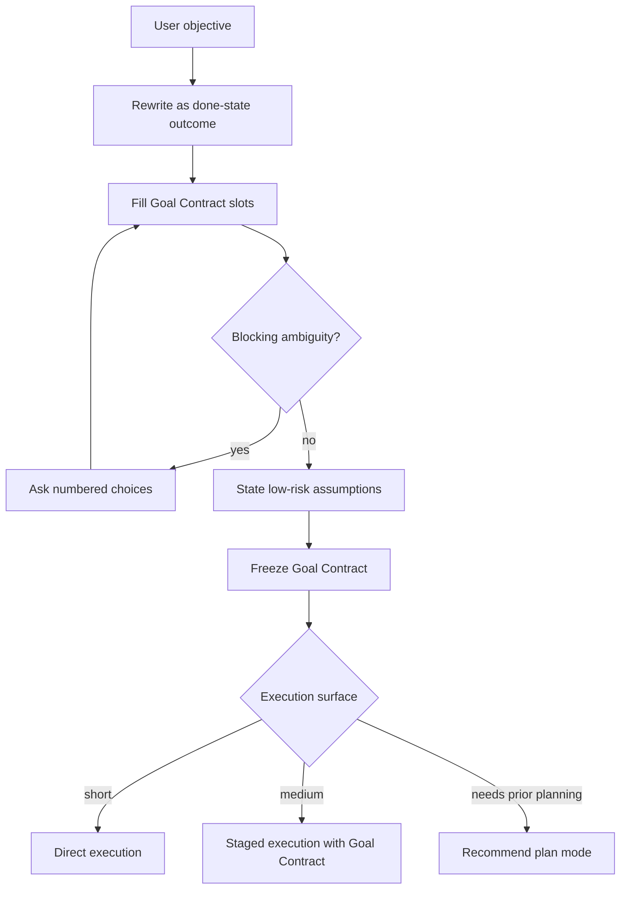
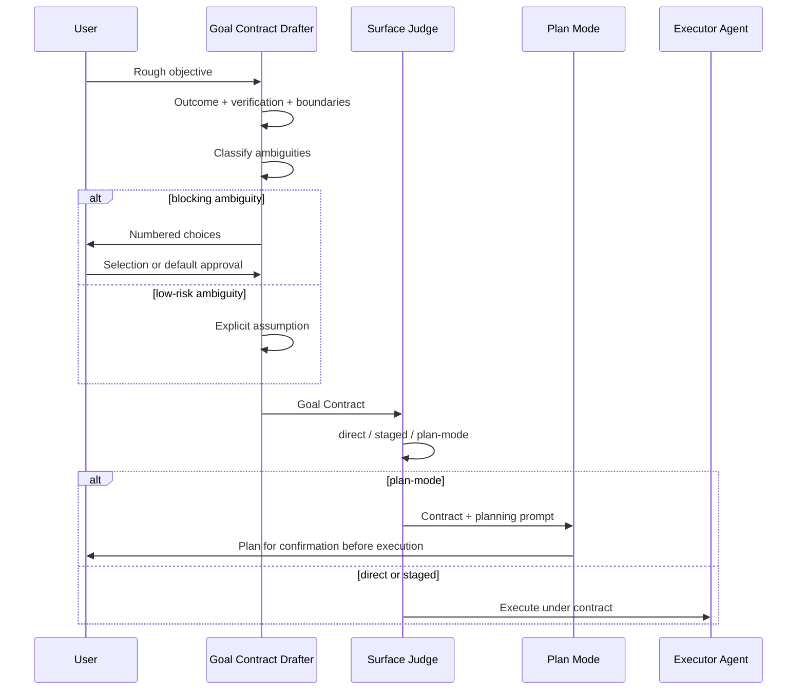

# Goal Contract Drafter

## Purpose

Turn a rough objective into an executable Goal Contract that a later agent can consume. This skill drafts the contract and recommends the execution surface; it does not execute the work.

Use it as the compiler between "I want to do X" and "an agent can now execute X safely."

## Core Flow



## Handoff Sequence



## Compact Steps

1. Rewrite the user's request as a done-state outcome.
2. Fill the Goal Contract slots.
3. Ask only about blocking ambiguities.
4. State low-risk assumptions and deferred decisions.
5. Freeze the contract and recommend either direct execution, staged execution, or plan mode.

## Drafting Workflow

Fill these slots:

- `outcome`: what must be true when done
- `verification`: commands, logs, screenshots, artifacts, API checks, files, or other evidence
- `constraints`: behavior, schema, public API, data, style, branch rules, or secrets that must not change
- `boundaries`: allowed writes, forbidden paths, systems out of scope
- `assumptions`: low-risk defaults that let work proceed
- `ambiguities`: split into `blocking`, `assumable`, and `deferred`
- `iteration_policy`: how to make progress after failures, including new evidence requirements
- `stop_when`: evidence that proves completion
- `pause_if`: human authorization, credentials, production state, destructive changes, regulated judgment, or unclear ownership

Ask the user only about `blocking` ambiguities. Prefer numbered choices with a recommended default.

## Ambiguity Rules

| Type | Meaning | Action |
|---|---|---|
| `blocking` | Changes direction, risk, scope, authority, or acceptance | Ask before freezing the contract |
| `assumable` | Low-risk default can be stated and reversed | State the assumption and continue |
| `deferred` | Can be decided during execution using new evidence | Record it; do not block drafting |

Do not turn all uncertainty into questions. The purpose is a usable contract, not an interview form.

## Surface Rules

Recommend `direct` when the task is small, local, and the completion evidence is obvious.

Recommend `staged` when the goal needs a contract but the work can be done in a normal turn or a few bounded steps.

Recommend `plan-mode` when the task needs user-visible planning before execution, has several possible approaches, needs scope negotiation, or should not be touched until the user confirms a plan.

Use `plan-mode` especially when the goal is multi-stage, the scope is uncertain, the work touches multiple systems, or execution may modify many files.

Goal Contract is about "what counts as done." Plan mode is about "how to approach it before touching execution."

## Output Shape

Use this shape by default:

```yaml
goal_contract:
  outcome:
  verification:
  constraints:
  boundaries:
  assumptions:
  ambiguities:
    blocking:
    assumable:
    deferred:
  iteration_policy:
  stop_when:
  pause_if:
surface_recommendation:
  type: direct | staged | plan-mode
  reason:
next_step:
  user_choice_needed:
  plan_mode_prompt_if_any:
```

For user-facing copy, add a concise natural-language version before the YAML when helpful.

## Quality Bar

A good Goal Contract:

- Has a done-state outcome.
- Names concrete evidence, not model confidence.
- Separates constraints from filesystem boundaries.
- States low-risk defaults explicitly.
- Keeps high-risk authorization with the user.
- Gives the next executor enough information to start without re-interviewing the user.
- Does not pretend every task needs plan mode.

Revise the contract if it contains placeholders, vague verification like "make sure it works," broad permission like "edit anything," or infinite retry language like "keep trying."

## Boundaries

Do not execute the drafted goal.

Do not create a plan unless the user explicitly asks or the requested deliverable is the plan itself.

Do not install, modify, or invoke other skills automatically. Recommend `plan-mode` when planning should happen before execution.

Do not copy external pause-condition lists wholesale. Express pause conditions using the local task's actual risk and authority boundaries.
